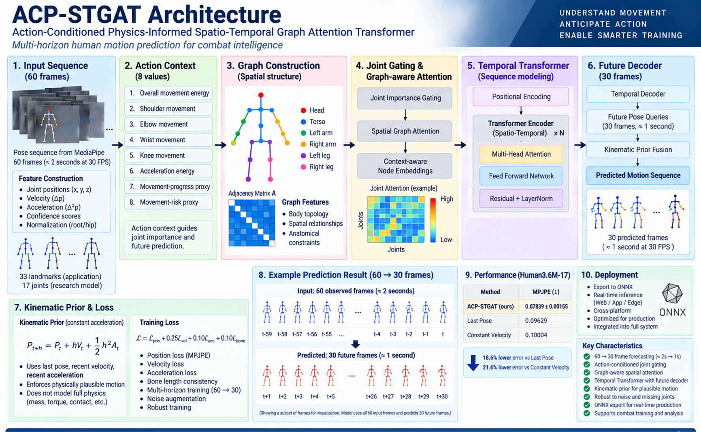
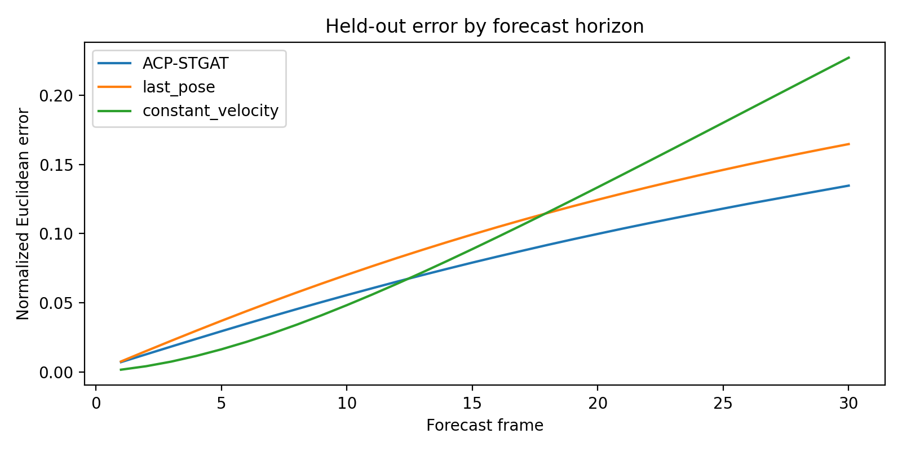

# ACP-STGAT | 3D Human Motion Forecasting

**Action-Conditioned Physics-Informed Spatio-Temporal Graph Attention Transformer**  
*Technical project report and reproducibility evidence · Martial Art AI / Combat Cognition Framework*

ACP-STGAT consumes a recent 17-joint three-dimensional skeleton window and predicts 30 future frames. The evaluation used a participant-held-out Human3.6M protocol with up to 10,000 test windows and three training seeds (42, 43 and 44). Performance was measured through normalized MPJPE/ADE, final displacement error and bone-length mean absolute error. Last-pose and constant-velocity predictors were included as required simple baselines. Robustness trials added coordinate noise and simulated missing landmarks. The selected model was exported to ONNX and compared numerically with its PyTorch output.

The live application uses MediaPipe-33 landmarks, whereas the offline benchmark uses a 17-joint representation. The benchmark therefore evaluates general forecasting capability and export readiness, not live tech prediction. No error is converted to a percentage or physical unit.

## Architecture

*Figure 1. Project architecture overview. The graphic combines the 30 FPS browser design target with the 17-joint benchmark results. Its skeletons and attention map illustrate the pipeline. The archived notebook defines the exact operation order, input features, and training procedure described below.*

## Benchmark protocol

| Setting | Archived Human3.6M-17 experiment |
| --- | --- |
| Dataset | Processed Human3.6M 3D pose sequences distributed via DDHPose |
| Preprocessing | Select 17 joints, subtract the pelvis per frame and divide by the sequence median pelvis-to-thorax distance |
| Split | Grouped by participant before generating windows. Held-out test participants were `S1` and `S11` |
| Windows | 60 observed frames followed by 30 target frames, stride 10. The test manifest contains 10,000 windows |
| Time scale | Native **50 FPS** in the archive. The history contains about **1.2 s** of samples and frame 30 is **0.6 s** after the last observation |
| Training | PyTorch on CUDA, AdamW, batch size 32, learning rate `3e-4`, weight decay `1e-4`, gradient norm clipping at `1.0` |
| Model selection | Seeds `42`, `43`, `44`, up to 60 epochs each, early-stopping patience 10. Each run restored the checkpoint with lowest validation MPJPE before test scoring |
| Baselines | Repeat the last observed pose, or extrapolate its most recent velocity one step at a time |

## Results

Lower is better. The model row reports mean ± sample standard deviation across the three seeds on the same held-out windows.

| Method | Normalized MPJPE / ADE | Final displacement error | Bone-length MAE |
| --- | ---: | ---: | ---: |
| **ACP-STGAT** | **0.07839 ± 0.00155** | **0.13639 ± 0.00237** | 0.00576 ± 0.00019 |
| Last pose | 0.09629 | 0.16470 | ≈ 0.00000 |
| Constant velocity | 0.10004 | 0.22710 | 0.02487 |

| Seed | Best validation epoch | Test MPJPE / ADE | Test FDE |
| ---: | ---: | ---: | ---: |
| 42 | 47 | 0.07741 | 0.13468 |
| 43 | 50 | 0.07759 | 0.13539 |
| 44 | 47 | 0.08018 | 0.13910 |

At the final frame, mean ACP-STGAT error was **17.2% lower than last pose** and **39.9% lower than constant velocity**. Constant velocity led at early frames, including frame 10, but its error exceeded the model's by frame 20. The frozen-pose baseline preserves bone lengths by keeping the skeleton static. ACP-STGAT reduced structural error relative to constant velocity while improving trajectory error over both baselines.

*Figure 2. Archived forecast error by frame. The ACP-STGAT curve uses seed 42, selected by validation MPJPE. The aggregate table uses all three seeds.*

## ONNX export and browser integration

| | Research export | Browser integration |
| --- | --- | --- |
| Skeleton | 17 Human3.6M joints | 33 MediaPipe landmarks |
| Input → output | `[B, 60, 17, 3]` → `[B, 30, 17, 3]` | 60 × 33 × 3 → 30 × 33 × 3 per sample |
| Forecast interval | 0.6 s at the recorded 50 FPS | About 1 s at the nominal 30 FPS |
| Evidence | Held-out benchmark and model-only ONNX Runtime CPU test | Separate ONNX model, runtime contract and forecast integration code |

The 17-joint export matched PyTorch on a held-out single-sample input with a maximum absolute difference of **1.19 × 10⁻⁷** and a mean difference of **1.84 × 10⁻⁹**, passing the `1e-4` threshold. ONNX Runtime CPU timing used up to 100 single-sample calls and measured **9.88 ms median** and **12.81 ms p95**. The timing covers model execution and its input conversion within the test loop.

In Martial Art AI, the browser predictor normalizes landmarks around the hip center using shoulder or torso scale. An optional forecast layer buffers observations, throttles model calls and updates per-horizon reliability by comparing predictions with subsequently observed landmarks. The forecast is advisory input to the coaching pipeline. 

## Colab notebook

- [View the complete notebook on GitHub](https://github.com/SachithBandaraThennakoon/martial-art-ai/blob/main/research/notebooks/ACP_STGAT_COMPLETE_TRAIN_EVALUATE_COLAB.ipynb)
- [Open the notebook in Google Colab](https://colab.research.google.com/github/SachithBandaraThennakoon/martial-art-ai/blob/main/research/notebooks/ACP_STGAT_COMPLETE_TRAIN_EVALUATE_COLAB.ipynb)

